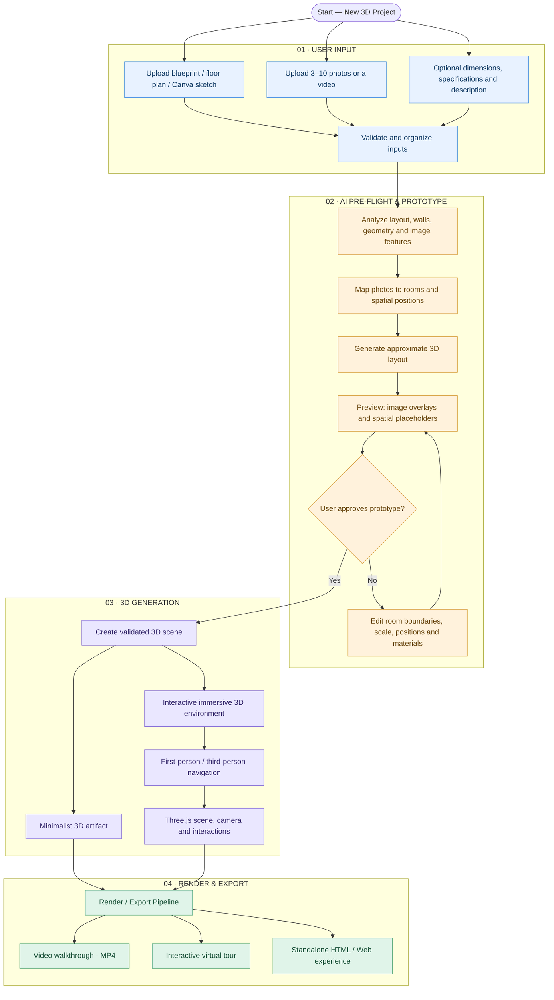

# AI 3D Vision

> [!info] Project workspace
> The associated implementation work is indexed in [[Tasks MOC]].

## Context and inputs

- Upload 5-10 images
- Upload apartment blueprint
- Upload blueprint sketch, canva drawing
- Upload specifitions or description
- show pre-evaluation

## Workflow

Workflow based on your Notion project, covering input collection, AI-assisted spatial reconstruction, editable 3D prototyping, visualization, and export.

INTERACTIVE WORKFLOW DIAGRAM

## Technical architecture — recommended implementation

1. Input & ingestion: React / TypeScript, file storage, OpenCV, FFmpeg

2. AI spatial analysis: Vision models, segmentation, layout inference, image-to-room matching

3. 3D scene generation: Three.js, React Three Fiber, Blender, glTF / GLB

4. Interactive delivery: Three.js, WebXR, browser rendering, video export

## Critical design decisions

1. Pre-flight before generation: Produce a lightweight, editable spatial approximation rather than an expensive, detailed model immediately.
2. Spatial consistency: Treat the blueprint as the primary layout reference. Map photographs to rooms and surfaces with confidence scores; avoid inventing geometry without identifying it as estimated.
3. Editable scene representation: Maintain one canonical 3D scene (geometry, materials, cameras, anchors) shared by the minimalist artifact and virtual tour.
4. Multiple exports from one model: Generate video, virtual tour, and HTML from the same approved scene rather than rebuilding the environment for each output.

Recommended MVP: Blueprint + photos → editable 2.5D/3D pre-flight scene → minimalist Three.js model → browser-based virtual tour. Introduce photorealistic reconstruction, automated camera paths, and video generation in subsequent iterations.

The key architectural distinction is that AI generates the spatial structure, while Three.js handles real-time visualization and navigation. A floor plan and a handful of photographs can support an approximate 3D representation, but not necessarily an accurate or photorealistic reconstruction without additional measurements or depth information.

### Cómo trabajamos

[[Convenciones git y PRs]] · [[Definition of Done]]

## Related design

[https://www.figma.com/design/5unPeruE2TiPBhoQb9V0IB/rooma?node-id=0-1&t=psSliMHSQInB3oYr-1](https://www.figma.com/design/5unPeruE2TiPBhoQb9V0IB/rooma?node-id=0-1&t=psSliMHSQInB3oYr-1)
