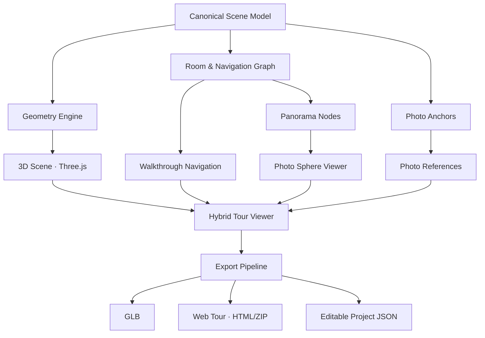

# Research tecnológico y competitivo — AI 3D Vision

Análisis de proyectos open source, Computer Vision, reconstrucción 3D, tours virtuales y tecnologías del mercado · Noviembre de 2026

## 1. Conclusión ejecutiva

La investigación apunta a una oportunidad concreta: combinar la reconstrucción geométrica de planos 2D con un editor 3D asistido por IA y un sistema de tours virtuales exportables, aprovechando tecnologías open source ya disponibles.

No recomiendo construir un motor 3D completo desde cero ni intentar reproducir directamente Matterport. Existen proyectos que resuelven partes importantes del problema y pueden acelerar el desarrollo.

Para [[AI 3D Vision]] distinguiría tres productos técnicamente diferentes:

A. Modelo geométrico 3D editable

Convierte un plano en habitaciones, paredes, puertas, ventanas y superficies navegables. Prioriza geometría coherente y edición.

B. Tour fotográfico panorámico

Conecta fotografías 360° mediante hotspots, minimapas y transiciones entre habitaciones. Produce una experiencia visual realista, pero no necesariamente un modelo geométrico real.

C. Reconstrucción fotorrealista

Utiliza fotogrametría, NeRF o 3D [[Gaussian Splatting]] para recuperar la apariencia y estructura de un espacio mediante múltiples capturas.

### Evaluación comparativa

Valoraciones técnicas propias, relativas al PRD y a sus restricciones actuales.

| Enfoque | Fidelidad visual | Geometría editable | Compatibilidad con 3–10 fotos convencionales | Prioridad |
| --- | --- | --- | --- | --- |
| Plano → 3D procedural | Media-baja | Alta | Alta, como referencias | 1 |
| Fotografías 360° conectadas | Alta | Baja | Requiere panoramas 360° | 2 |
| Fotogrametría SfM/MVS | Alta si la captura es adecuada | Media | Generalmente insuficientes | 3 |
| [[Gaussian Splatting]] | Muy alta si la captura es adecuada | Baja para edición CAD | Generalmente insuficientes | 4 |
| IA generativa 3D desde pocas fotos | Variable | Baja | Experimental | 5 |

El condicionante crítico está en los datos: 3–10 fotografías normales de un inmueble no garantizan cobertura ni solapamiento suficientes para reconstruir fielmente todas sus habitaciones. Los flujos comerciales de captura inmersiva utilizan panoramas, múltiples puntos de observación o sensores de profundidad.

Por tanto, la propuesta debe separar dos promesas comerciales:

- MVP: generar una aproximación espacial editable a partir de un plano y referencias visuales.
- Producto avanzado: producir experiencias fotográficas o reconstrucciones fotorrealistas cuando la captura de origen lo permita.

Esta separación evita que el producto prometa una precisión que sus entradas no pueden garantizar.

## 2. Los proyectos open source más útiles

Estos son los repositorios que priorizaría para estudiar, ejecutar localmente o integrar. La valoración considera el encaje con [[AI 3D Vision]], la reutilización de código y el riesgo de integración; no equivale a una auditoría completa de calidad.

### A. Editores arquitectónicos y generación 2D → 3D

[Pascal Editor](https://github.com/pascalorg/editor?utm_source=chatgpt.com)

React · Three.js · R3F · Zustand · MIT

Un editor arquitectónico modular con paredes, aperturas, habitaciones, objetos, estado persistente y arquitectura extensible mediante plugins. Ofrece paquetes reutilizables como `@pascal-app/core`.

Valor: puede ahorrarte la implementación de buena parte de la edición geométrica y del modelo de escena.

Riesgo: requiere adaptar su estructura y comprobar el alcance de sus APIs publicadas.

[Weekly Web Design & Development News: Collective #105 | jQuery Script](https://images.openai.com/static-rsc-4/beU0J9P_ssPJD6eeOu0apy9dhGMGbrjFVVT98Xuani6fTU1RUEyZLlpwFiQ7Vi1ySL-ICh25DNJVJUqD2UP_8niFEtqqWBjMVa7ZxiAwFiQcQ9wp7F29qrsRcXBOfcFMG-W3mP48iNTBuNB6dBwa8Dp5M0lQOCA45zph1mh3_Gg?purpose=inline)

[Blueprint3D Modern](https://github.com/charmlinn/blueprint3d-modern?utm_source=chatgpt.com)

TypeScript · Three.js · MIT

Incluye herramientas de dibujo de paredes, snapping, mediciones, habitaciones y visualización 3D. Su código separa el floorplanner, el modelo y el renderizador.

Valor: excelente referencia para construir un editor más ligero que Pascal.

Riesgo: el propio proyecto mantiene pendientes tests, undo/redo y algunas funciones de exportación. No lo consideraría un SDK de producción ya validado.

[OpenPlan3D: Free Open Source Floor Plan Editor | 2D & 3D Home Design](https://images.openai.com/static-rsc-4/uxCNoO3Ro2b-5UtY3fv8Fbtkh4zJXHzgvukF4jd1O6SY0NFPin-3-1EutlA2SbZ-karL24IV4eedUrlmtKQXgMqUXARcWUtFJVDj5KVPic29Z0mQDWjmuwwZB7IuHjNvgr8szTz9lYjgx9_aOR09JoLZf2TokRQffyrnTItpGb4?purpose=inline)

[OpenPlan3D](https://openplan3d.com/?utm_source=chatgpt.com)

Editor 2D/3D · Geometría arquitectónica

Editor web para planos, habitaciones, medidas, puertas, ventanas y visualización 3D. Incluye importación de capturas Apple RoomPlan y exportaciones técnicas.

Valor: referencia funcional para UX, modelado manual y precisión dimensional.

Revisaría su código, licencia y estructura modular antes de plantear una integración directa.

[Floorplan-to-3D](https://github.com/Yytsi/floorplan-to-3d?utm_source=chatgpt.com)

Python · ResNet-UNet · OpenCV · FastAPI · Three.js

Es el proyecto que más se aproxima al pipeline concreto del PRD: segmenta paredes, puertas, ventanas y suelo; extrae polígonos y genera una escena extruida.

Valor: especialmente útil como prueba de concepto de Computer Vision y referencia de implementación.

Riesgo elevado de reutilización directa: proyecto pequeño y entrenamiento sobre CubiCasa5K, cuyo dataset tiene licencia no comercial.

### B. Frameworks para tours virtuales

| Proyecto | Capacidades importantes | Licencia | Encaje |
| --- | --- | --- | --- |
| [Photo Sphere Viewer](https://photo-sphere-viewer.js.org/?utm_source=chatgpt.com) | Panoramas 360°, hotspots, tour graph, minimapa, plano y galería | MIT | Excelente |
| [Marzipano](https://www.marzipano.net/?utm_source=chatgpt.com) | Tours panorámicos, hotspots, imágenes multirresolución y exportación web | Consultar repositorio | Muy alto |
| [Pannellum](https://pannellum.org/?utm_source=chatgpt.com) | Visor 360° ligero, hotspots y panoramas multirresolución | MIT | Alto |
| [LibreTours 360](https://github.com/wishmerhill/libretours-360?utm_source=chatgpt.com) | Editor de tours, hotspots, planos, exportación HTML/ZIP y modo offline | GPL-3.0 | Excelente referencia; cautela al integrar |
| [Andarama](https://docs.andarama.com/?utm_source=chatgpt.com) | Studio, viewer HTML exportable y backend para tours 360° | EUPL-1.2 | Referencia de arquitectura |

Photo Sphere Viewer proporciona directamente un plugin de tours que conecta panoramas mediante nodos y enlaces, además de plugins para mapas, planos y marcadores. Es la alternativa que escogería antes de desarrollar un visor panorámico propio.

Hallazgo interesante: LibreTours 360 resuelve dos necesidades muy concretas de tu PRD: un editor que exporta experiencias web y un paquete independiente que conserva imágenes, hotspots y plano. También distingue las exportaciones web de aquellas que funcionan directamente desde `file://`, donde pueden aparecer restricciones de carga de recursos.

### C. Reconstrucción de imágenes y fotorrealismo

| Proyecto | Tecnología | Utilidad para [[AI 3D Vision]] | Cuándo incorporarlo |
| --- | --- | --- | --- |
| [COLMAP](https://colmap.github.io/?utm_source=chatgpt.com) | Structure-from-Motion y Multi-View Stereo | Recuperar cámaras y geometría a partir de fotografías solapadas | Captura avanzada |
| [Meshroom](https://meshroom.org/?utm_source=chatgpt.com) | Fotogrametría por nodos | Experimentar con reconstrucciones y pipelines repetibles | I+D |
| [VGGT](https://github.com/facebookresearch/vggt?utm_source=chatgpt.com) | Predicción de poses, profundidad y geometría multivista | Estimar estructura espacial desde pocas vistas | Spike de viabilidad |
| [Nerfstudio](https://github.com/nerfstudio-project/nerfstudio?utm_source=chatgpt.com) | NeRF y [[Gaussian Splatting]] | Entrenar representaciones visuales de escenas | Post-MVP |
| [gsplat](https://docs.gsplat.studio/?utm_source=chatgpt.com) | Gaussian rasterization CUDA | Entrenar y procesar splats | Post-MVP |
| [SuperSplat](https://github.com/playcanvas/supersplat?utm_source=chatgpt.com) | Editor de Gaussian Splats | Limpiar, optimizar y publicar reconstrucciones | Post-MVP |
| [TRELLIS.2](https://github.com/microsoft/TRELLIS.2?utm_source=chatgpt.com) | Generación de activos 3D con IA | Generar objetos o mobiliario individual | Futuro |

COLMAP es una base sólida para reconstrucción multivista tradicional; Nerfstudio y gsplat son herramientas más indicadas para la representación fotorrealista. SuperSplat aporta un editor web de Gaussian Splats que evita desarrollar herramientas propias de limpieza y publicación.

VGGT merece un spike independiente. Puede predecir poses de cámara, profundidad y mapas de puntos a partir de varias imágenes, y exportar resultados compatibles con COLMAP. No garantiza, sin embargo, una reconstrucción arquitectónicamente correcta de partes no observadas.

### D. Componentes 3D reutilizables

| Librería | Función concreta |
| --- | --- |
| `@react-three/fiber` | Construcción de escenas 3D integradas en React |
| `@react-three/drei` | Cámaras, controles, Gizmos y utilidades |
| `three` | Geometría, materiales, renderización y GLB |
| [three-mesh-bvh](https://github.com/gkjohnson/three-mesh-bvh?utm_source=chatgpt.com) | Raycasting acelerado y consultas espaciales |
| [three-bvh-csg](https://github.com/gkjohnson/three-bvh-csg?utm_source=chatgpt.com) | Operaciones booleanas para huecos y aperturas |
| [recast-navigation-js](https://github.com/isaac-mason/recast-navigation-js?utm_source=chatgpt.com) | Navmesh y cálculo de rutas navegables |
| [glTF Transform](https://gltf-transform.dev/?utm_source=chatgpt.com) | Optimización, compresión y transformación de modelos |
| [splat-transform](https://github.com/playcanvas/splat-transform?utm_source=chatgpt.com) | Conversión y optimización de formatos Gaussian Splat |

Hay dos matices de implementación relevantes. `three-bvh-csg` documenta limitaciones numéricas y posibles conflictos al exportar geometría resultante; por eso utilizaría operaciones booleanas únicamente cuando no puedas construir los huecos directamente mediante geometría paramétrica. `recast-navigation-js` es útil si incorporas navegación avanzada, pero puede ser excesivo para un recorrido básico sin obstáculos dinámicos.

### Riesgos de licencias descubiertos

La licencia no es un detalle secundario en este proyecto:

| Recurso | Situación verificada | Implicación |
| --- | --- | --- |
| Pascal Editor | MIT | Favorable para reutilización comercial |
| Blueprint3D Modern | MIT | Favorable |
| Photo Sphere Viewer | MIT | Favorable |
| SuperSplat | MIT | Favorable |
| SAM 2 | Apache-2.0 para código y checkpoints publicados | Favorable, revisando dependencias |
| CubiCasa5K | CC BY-NC 4.0 | No asumir autorización comercial |
| DUSt3R / MASt3R | CC BY-NC-SA 4.0 | No integrar sin licencia comercial adecuada |
| VGGT | Licencia específica; checkpoint comercial separado | Verificar autorización y condiciones del checkpoint |
| LibreTours 360 | GPL-3.0 | Obligaciones de copyleft al redistribuir o integrar código |

El punto más delicado es CubiCasa5K. Que un repositorio de entrenamiento tenga una licencia permisiva no implica que puedas utilizar comercialmente todos sus datasets o pesos entrenados. Para un SaaS comercial, separaría experimentación y producción hasta resolver los derechos correspondientes.

## 3. Cómo construir realmente los tours virtuales

Mi propuesta es construir un Hybrid Tour Engine que soporte dos modos de navegación sobre un mismo modelo espacial: un recorrido geométrico en Three.js y, cuando existan panoramas compatibles, un recorrido fotográfico 360°.

### Arquitectura del tour



## Pipeline completo: plano y fotos → modelo 3D → artefactos

1. Ingesta y normalización
    
    PyMuPDF · OpenCV · Pillow
    
    Detectar si el PDF contiene primitivas vectoriales o si debe rasterizarse. Normalizar orientación, resolución y escala.
    
2. Interpretación del plano
    
    OpenCV · segmentación opcional · Shapely
    
    Detectar paredes, habitaciones y aperturas. Extraer líneas centrales y polígonos, simplificar contornos y resolver intersecciones.
    
3. Canonical Scene Model
    
    Pydantic · JSON Schema · Zod
    
    Transformar las predicciones a un contrato estructurado, con identificadores estables, coordenadas, unidades, topología y procedencia de cada elemento.
    
4. Preflight editable
    
    React Konva · Zustand · Three.js
    
    Mostrar propuestas y permitir corregir paredes, puertas, alturas, escala y asociaciones de fotografías antes de aprobarlas.
    
5. Procedural Geometry Engine
    
    Three.js · ExtrudeGeometry · BufferGeometry
    
    Construir meshes de paredes, suelos, aperturas y techos opcionales. Crear materiales y optimizar geometría.
    
6. Tour Builder
    
    R3F · Drei · Grafo de habitaciones
    
    Generar posiciones navegables, cámaras y rutas válidas. Asociar hotspots fotográficos y panorámicos si existen.
    
7. Export & Delivery
    
    GLTFExporter · glTF Transform · fflate
    
    Generar GLB y paquete web autónomo con visor, recursos y manifiesto. Validar el artefacto exportado antes de entregarlo.
    

### Modelo geométrico: un aspecto que no debes simplificar demasiado

La segmentación de píxeles no basta como modelo final.

Necesitas identificar topología y relaciones: paredes compartidas entre habitaciones, puertas que conectan espacios, orientación de superficies y aperturas vinculadas a una pared.

Un conjunto de polígonos extruidos directamente desde máscaras puede producir paredes duplicadas, puertas bloqueadas y geometrías incoherentes.

Para evitarlo, construiría un Wall Graph intermedio:

```
Scene
 ├── Levels
 ├── Walls
 │    ├── Endpoints
 │    ├── Thickness / Height
 │    └── Openings
 ├── Rooms
 │    ├── Boundary
 │    └── Wall references
 ├── Materials
 ├── Photo Anchors
 └── Tour
      ├── Camera Positions
      ├── Navigation Links
      └── Hotspots
```

`scene.glb` debe contener la geometría y los materiales. `scene.json` conserva la información paramétrica para volver a editar el proyecto. `navigation.json` almacena los enlaces, posiciones de cámara y hotspots, que no deben depender de que el formato GLB los interprete de manera propietaria.

Para optimizar los modelos utilizaría glTF Transform, que permite comprimir geometrías con Draco o Meshoptimizer y tratar texturas mediante WebP o KTX2.

Distinguiría dos modalidades de entrega: un ZIP desplegable en hosting estático y, si se requiere, un paquete que pueda abrirse sin servidor. Un HTML con recursos relativos no garantiza por sí solo funcionamiento offline mediante doble clic, por las restricciones de seguridad de los navegadores.

## 5. Evaluación de las técnicas utilizadas por el mercado

La competencia confirma que no existe una única técnica predominante. Los productos se especializan en reconocimiento de planos, captura espacial o experiencias panorámicas.

### Comparativa de soluciones comerciales

| Producto | Técnica principal | Qué consigue | Lección para [[AI 3D Vision]] |
| --- | --- | --- | --- |
| Matterport | Captura espacial, panoramas y profundidad | Digital twins, vista Dollhouse y recorridos inmersivos | Referencia de UX y fidelidad; requiere un flujo de captura más rico |
| Zillow 3D Home | Captura de panoramas y procesamiento espacial | Tour 360° y planos interactivos | La adquisición estructurada de imágenes es fundamental |
| Planner 5D | Reconocimiento de planos y modelado editable | Importar plano, editar geometría y generar 3D | Competidor directo en plano → 3D |
| RoomSketcher | AI Convert y edición posterior | Convierte planos claros en layouts editables | Valida el enfoque de preflight y corrección manual |
| [[Polycam]] | Fotogrametría, splats y LiDAR | Modelos de objetos y espacios escaneados | Tecnología complementaria para captura avanzada |
| Kuula | Panoramas enlazados + hotspots | Tours visuales interactivos con plano | El tour no necesita reconstrucción 3D compleja |
| 3DVista | Panoramas, escenas multimedia y modelos 3D | Tour distribuible online y offline | Referente en exportación y presentación comercial |

### Hallazgos competitivos relevantes

Matterport y Zillow: la captura es parte del producto. Matterport comercializa cámaras LiDAR y utiliza datos dimensionales junto con imágenes. Zillow exige una cámara 360° compatible para su funcionalidad de plano interactivo y dispone de un proceso propio de captura. No son equivalentes a subir unas pocas fotos arbitrarias.

Planner 5D y RoomSketcher: la conversión de planos ya es una funcionalidad comercial. Ambos permiten convertir un plano en un proyecto editable. RoomSketcher incluso documenta que su reconocimiento funciona mejor con planos claros generados por ordenador y que los bocetos a mano no están soportados por AI Convert. Por tanto, convertir un PDF a paredes 3D no constituye por sí solo una diferenciación suficiente.

Kuula y 3DVista: la experiencia final puede ser mucho más sencilla que la tecnología de reconstrucción. Su producto principal consiste en organizar y conectar contenido visual, con navegación, hotspots y planos. Demuestran que se puede ofrecer valor comercial sin recuperar una malla 3D detallada.

## ## 6. Valoración de las técnicas de reconstrucción

Escala orientativa de 1–5. Son estimaciones de encaje técnico para este MVP, no benchmarks publicados.

### Criterios de comparación

- Encaje con MVP
- Fidelidad visual
- Editabilidad
- Coste técnico

### Encaje con el MVP

| Técnica | Valoración |
| --- | --- |
| Geometría procedural desde plano | 5/5 |
| Segmentación ML de planos | 4/5 |
| Tour con panoramas 360° | 4/5 |
| SfM + fotogrametría | 2/5 |
| [[Gaussian Splatting]] | 2/5 |
| Generación 3D por IA | 2/5 |

### Interpretación técnica

Geometría procedural + segmentación de planos: mejor relación entre coste, control y calidad geométrica. Es repetible, fácil de validar y adecuada para exportar GLB. La debilidad es la calidad visual, que dependerá de materiales, iluminación y referencias fotográficas.

Reconstrucción multivista y [[Gaussian Splatting]]: útiles para escenas visualmente fieles, pero requieren cobertura suficiente, posiciones de cámara coherentes y procesamiento más exigente. Son difíciles de editar como paredes, puertas y superficies arquitectónicas. Por eso los trataría como una capa visual adicional, no como sustituto del modelo canónico.

Modelos de profundidad o reconstrucción desde pocas imágenes: VGGT y SAM 2 pueden complementar el análisis espacial o la segmentación. No sustituyen automáticamente la inferencia de topología arquitectónica ni la calibración métrica. Un ejemplo de técnica que no priorizaría es RoomFormer: pese a su nombre, su implementación publicada trabaja sobre mapas de densidad derivados de nubes de puntos, no directamente sobre los PDF/JPG de planos previstos en el MVP.

## 7. Posicionamiento de [[AI 3D Vision]]

Considero que el mayor potencial está en un flujo AI-assisted, editable, exportable y independiente del hardware, no en competir en fidelidad con los sistemas de escaneo profesional.

El segmento más razonable para validar inicialmente sería el de profesionales que ya disponen de planos y fotografías: inmobiliarias pequeñas, agencias de marketing inmobiliario, gestores de propiedades y estudios de interiorismo que necesitan una representación navegable rápida.

La propuesta de valor podría formularse así:

> Convierte planos de planta en espacios 3D editables y tours web reutilizables, con fotografías asociadas y sin necesidad de un escáner 3D especializado.
> 

Esto no significa que carezcas de competencia. Planner 5D y RoomSketcher ya cubren una parte importante de la conversión 2D → 3D. El posible diferencial es integrar en un solo flujo el preflight asistido, la escena paramétrica, la navegación web y la entrega independiente, con menor fricción para usuarios no especializados.

No hay evidencia suficiente en esta investigación para afirmar que esa combinación esté desatendida comercialmente. Habría que contrastarla mediante pruebas de producto y entrevistas a clientes.

## 8. Hoja de ruta de evaluación y adopción

| Fase | Prueba técnica | Tecnologías candidatas | Resultado esperado |
| --- | --- | --- | --- |
| P0 | Evaluar editores existentes | Pascal, Blueprint3D Modern | Decidir reutilización frente a desarrollo propio |
| P0 | Crear escena manual canónica | TypeScript, R3F, Three.js | Plano editable y escena consistente |
| P1 | Reconocer planos reales | PyMuPDF, OpenCV, Shapely | Paredes, habitaciones y aperturas propuestas |
| P1 | Validar inferencia ML | Modelo propio, segmentación | Medir mejora frente a la solución clásica |
| P1 | Generar tour en primera persona | Drei, raycasting, room graph | Navegación correcta entre habitaciones |
| P1 | Exportar artefactos | GLTFExporter, glTF Transform, fflate | GLB y web ZIP reproducibles |
| P2 | Incorporar panoramas 360° | Photo Sphere Viewer | Tour visual con hotspots y plano |
| P3 | Evaluar reconstrucción multivista | VGGT comercial, COLMAP | Determinar calidad y cobertura mínima |
| P3 | Evaluar splats | Nerfstudio, gsplat, SuperSplat | Reconstrucción visual avanzada |

### Métricas que utilizaría para decidir

Mediría la precisión de paredes y habitaciones, error dimensional tras calibración, porcentaje de planos que llegan a una escena válida, tiempo de corrección manual, estabilidad del recorrido, rendimiento del visor, tamaño de los artefactos y coste de procesamiento por proyecto.

Para cada algoritmo de Computer Vision utilizaría un conjunto de planos reales separado de los datos de desarrollo, con ejemplos sencillos y complejos. Sin ese benchmark, cambiar OpenCV por un Transformer puede aumentar el coste sin mejorar el outcome.

## 9. Stack final ajustado a los hallazgos

| Subsistema | Selección recomendada |
| --- | --- |
| Aplicación web | React, TypeScript, Vite |
| Editor arquitectónico | Evaluar Pascal Core; alternativa propia con React Konva |
| Modelo geométrico | Canonical Scene Model + Wall Graph |
| Render y generación 3D | Three.js, React Three Fiber, Drei |
| Geometría avanzada | Shapely, three-mesh-bvh; CSG selectivo |
| Navegación | Controles Three.js; Recast Navigation si se justifica |
| Tours panorámicos | Photo Sphere Viewer, opcional |
| Backend | FastAPI, Pydantic |
| Procesamiento de planos | PyMuPDF, OpenCV, NumPy, Shapely |
| Machine Learning | PyTorch y modelos evaluados sobre datos con licencia adecuada |
| Procesamiento asíncrono | Celery, Redis |
| Base de datos | PostgreSQL / Supabase |
| Artefactos | GLB, JSON, HTML, ZIP |
| Optimización 3D | glTF Transform, Meshoptimizer/Draco |

## Recomendación final

El stack inicial de React + Three.js + FastAPI sigue siendo adecuado, pero esta investigación cambia una decisión de implementación: no empezaría programando el editor arquitectónico desde cero.

Primero validaría si los paquetes de Pascal Editor pueden integrarse directamente en la aplicación o si Blueprint3D Modern aporta una base más sencilla. En paralelo, aprovecharía el proyecto Floorplan-to-3D exclusivamente como referencia de investigación para segmentación, vectorización y extrusión, con especial atención a las licencias de los datos.

La arquitectura debería permitir incorporar tres motores sin cambiar el modelo de negocio ni la persistencia: geometría procedural como núcleo, tours panorámicos como capacidad complementaria y reconstrucción fotorrealista como evolución.

La inversión técnica más importante es el modelo canónico y su editor. Una vez sean fiables, podrás añadir distintos métodos de captura, IA y renderizado sin tener que reconstruir el sistema.

Fuentes principales: repositorios oficiales de GitHub, documentación de Three.js y Photo Sphere Viewer, y documentación de producto de Matterport, Zillow, Planner 5D, RoomSketcher, [[Polycam]] y Kuula. Investigación basada en capacidades documentadas; no se han ejecutado benchmarks comparativos propios.
